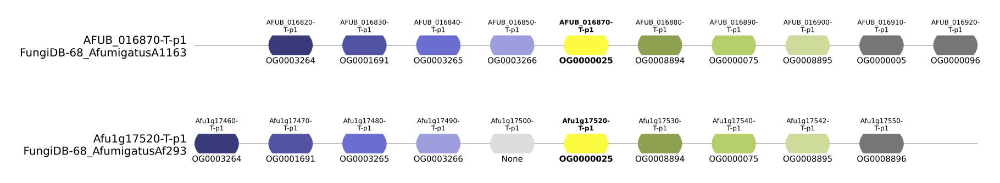

[](https://github.com/stajichlab/orthoSynAssign/actions/workflows/ci.yml)
[](https://github.com/stajichlab/orthoSynAssign/actions/workflows/ci.yml)
[](https://codecov.io/gh/stajichlab/orthoSynAssign)
[](https://orthosynassign.readthedocs.io/en/latest/)
[](https://github.com/stajichlab/orthoSynAssign/blob/main/LICENSE)
[][Bioconda]
[][Bioconda]
[](https://doi.org/10.64898/2026.08.10.744007)

# orthoSynAssign

**orthoSynAssign** (Ortholog Synteny Assignment Tool) is a Python tool to refine orthologous groups using synteny information inferred from genome annotation files (BED converted from GFF3/GTF). It is a Python re-implementation of [OrthoRefine], addressing sample-matching and memory-usage issues in the original C++ tool, with core synteny analysis implemented in [Rust] for speed and efficiency.

Described in the preprint: [orthoSynAssign: refine orthogroups using synteny information (bioRxiv, 2026)](https://www.biorxiv.org/content/10.64898/2026.08.10.744007v1).

---

## Quick Installation

### Via Conda (Recommended)

```sh
conda install bioconda::orthosynassign
```

### Via Pixi

```sh
pixi global install -c bioconda orthosynassign
```

*For alternative installation options (source, developer setup), see the [Installation Guide](https://github.com/stajichlab/orthoSynAssign/wiki/Installation).*

---

## Quick Start Example

```sh
cd example

# Refine OrthoFinder orthogroups using synteny from the BED annotation files
orthosynassign --og_file orthogroups.tsv --bed *.bed -o Refined_SOGs.tsv

# Visualize a refined syntenic orthogroup (SOG) for verification
orthosynassign-vis --og_file orthogroups.tsv --sog_file Refined_SOGs.tsv --bed *.bed --sog SOG000023.OG0000025 -f svg
```

<p align="center">
  
</p>

---

## Documentation

Detailed documentation, full CLI argument references, and technical deep-dives are available at **[orthosynassign.readthedocs.io](https://orthosynassign.readthedocs.io/)**:

- **[Installation](https://orthosynassign.readthedocs.io/en/latest/installation.html)** — Bioconda, Pixi, source, and developer setup.
- **[Preparing Input Files](https://orthosynassign.readthedocs.io/en/latest/input-files.html)** — OrthoFinder orthogroup files, converting GFF3/GTF to BED with `gff2bed.py`, and the isoform delimiter convention.
- **[Quick Start](https://orthosynassign.readthedocs.io/en/latest/quickstart.html)** — Walkthrough using the bundled `example` dataset.
- **Command Reference**:
  - **[orthosynassign](https://orthosynassign.readthedocs.io/en/latest/usage/orthosynassign.html)** — Main refinement command: options, window/ratio thresholds, output format.
  - **[orthosynassign-vis](https://orthosynassign.readthedocs.io/en/latest/usage/orthosynassign-vis.html)** — Visualization command for verifying refined orthogroups.
- **[Pipeline Architecture & Benchmarks](https://orthosynassign.readthedocs.io/en/latest/architecture.html)** — Algorithm overview and multithreading scalability benchmarks.
- **[Citation and References](https://orthosynassign.readthedocs.io/en/latest/citation.html)** — Publication metadata and citations for underlying dependencies.

---

## Citation

If you use orthoSynAssign in your research, please cite:

> Tsai, C.-H., Pina Paez, C. G., & Stajich, J. E. (2026). orthoSynAssign: refine orthogroups using synteny information. *bioRxiv*. DOI: [10.64898/2026.08.10.744007](https://doi.org/10.64898/2026.08.10.744007)

---

## Contributing

Contributions are welcome! Please feel free to submit a Pull Request.

[OrthoRefine]: https://github.com/jl02142/OrthoRefine
[Rust]: https://rust-lang.org/
[Bioconda]: https://anaconda.org/bioconda/orthosynassign
